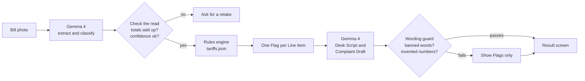
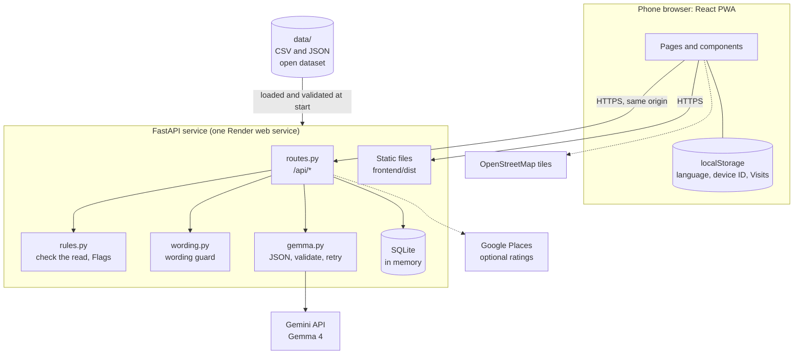

# Haki Afya

**Check your hospital bill against SHA rules before you pay.**

Haki Afya is a mobile web app for people in Nairobi who hold Social Health Authority (SHA) cover. Photograph a hospital bill and, in about thirty seconds, see which charges SHA should have covered, which sit above the SHA tariff, and what to say at the billing desk. Before care, it helps you find a contracted facility near you that offers what you need. Afterwards, it records what people actually paid, so the next patient has better information.

It was built for the Hacktoberfest Hack Day Nairobi x B54 (MLH), 24 October 2026, and uses **Gemma 4** to read the bill.

> Not legal or medical advice. Tariffs may have changed; confirm with SHA.

---

## Contents

- [The problem](#the-problem)
- [What it does](#what-it-does)
- [How Bill Check works](#how-bill-check-works)
- [Architecture](#architecture)
- [Data](#data)
- [API](#api)
- [Safety and privacy rules](#safety-and-privacy-rules)
- [Running it locally](#running-it-locally)
- [Testing](#testing)
- [Deploying](#deploying)
- [Repository layout](#repository-layout)
- [Project status](#project-status)
- [Documentation](#documentation)
- [License](#license)

---

## The problem

The hospital knows what SHA covers. The person standing at the billing desk, usually a relative paying for someone else, does not. Patients with SHA cover are still being asked to pay for services SHA should cover, and they usually find out afterwards. In June 2026 SHA suspended a Nairobi hospital after complaints that patients had paid out of pocket for covered services. Hospitals, for their part, report long delays in being paid by SHA.

The tools that exist today confirm that you are registered or list which facilities are contracted. None of them looks at the bill in your hand.

The full write-up, with sources and a confidence rating on every claim, is in [`research.md`](./research.md).

## What it does

Haki Afya covers the whole patient journey in three connected features.

| Feature | When | What you get |
|---|---|---|
| **Find** | Before care | Type what you need in English or Swahili, or tap a category. See nearby facilities that offer it, what SHA covers there at that facility's level, and what other patients reported paying. |
| **Bill Check** | At the desk | Photograph the bill. Every line is marked Should Be Free, Above Tariff, Payable or Unclear, with the amount in question in shillings. You also get a short Desk Script to say aloud and a Complaint Draft addressed to SHA. |
| **Report** | After care | Two hours after you choose a facility, the app asks whether you paid anything. Your answer, or a checked bill, becomes a Coverage Report that feeds back into Find. |

Everything is available in English and Swahili. There are no accounts; the only identity is a random device ID kept in the browser.

A fair bill is told it looks fair. The app is meant to be accurate, not adversarial.

## How Bill Check works

The central rule of the project is that **AI reads, code decides**. Gemma 4 turns a photo into structured data and later turns structured results into polite wording. It never decides whether a charge is a problem. That is done by plain code comparing each line to a published tariff table.



1. **Extract.** Gemma reads the image and returns every Line Item with a category and a confidence score, plus the subtotal, the SHA deduction and the balance.
2. **Check the read.** The Line Items must add up to the printed subtotal within 1 percent, and average confidence must be at least 0.6. If not, the app asks for a retake rather than guessing.
3. **Apply the rules.** Each Line Item gets exactly one Flag:

   | Flag | Meaning |
   |---|---|
   | Should Be Free | A rule says SHA covers this and the patient was charged. |
   | Above Tariff | The unit price is higher than the SHA tariff. The difference times the quantity is the amount in question. |
   | Payable | An excluded item, or no rule applies. |
   | Unclear | Low confidence, or the line could not be categorised. |

   Whether the patient is registered, and whether they were referred or it was an emergency, change which rules apply. The total amount in question is capped at the balance the patient is actually asked to pay.
4. **Write.** Gemma is given only the Flags, never the image, and writes a Desk Script of three sentences or fewer and a Complaint Draft in the chosen language.
5. **Guard the wording.** Before anything reaches the user, code rejects text that contains an accusatory word or an amount that was not in the input. If the text fails, the Flags are shown without it.
6. **Save a Verified Report.** If a listed facility was chosen and the patient is registered, one anonymised Coverage Report per service category is saved. The photo itself is never stored.

## Architecture

### System overview

One deployable unit. FastAPI serves the API under `/api` and the built React app from everywhere else, so the browser talks to a single origin and there is no CORS configuration.



### Backend

Python 3.12, FastAPI, Pydantic, the `google-genai` SDK and the standard library `sqlite3`. Each module has one job.

| Module | Responsibility |
|---|---|
| `main.py` | App setup, startup seeding, error shape, serves `frontend/dist` |
| `routes.py` | The HTTP endpoints. Shapes follow the contract in `document.md` section 9 |
| `rules.py` | Checks the read, applies tariff rules, produces Flags, caps the amount in question, drafts Verified Reports |
| `gemma.py` | Three calls to Gemma 4: classify a Care Need, extract a Bill, write the dispute text. JSON only, validated with Pydantic, one retry, 20 second timeout, temperature 0 |
| `wording.py` | Rejects generated text containing banned words (English and Swahili) or amounts that were not supplied |
| `emergency.py` | Keyword check, in code, before any model call |
| `data.py` | Loads and validates every file in `data/`. A file that breaks a hard rule stops startup |
| `db.py` | SQLite schema, Coverage Report counts over a 90 day window, a one-report-per-device rate limit |
| `places.py` | Optional Google rating lookup, cached, fails quietly |
| `messages.py` | Every user-facing string the backend returns, in English and Swahili |
| `models.py` | Pydantic models shared across the above |
| `mocks.py` | Contract example responses, used by `?mock=ok` and `?mock=retake` |

Prompts are plain Markdown files in `backend/prompts/` so they can be read and reviewed without touching code.

**Startup seeding.** SQLite is rebuilt from `data/` on every start. Nothing is migrated. A deploy always reflects exactly what is committed. The database is held in memory unless `HAKI_DB_PATH` is set.

**Failure behaviour.** Every Gemma call has a defined fallback, so a model outage degrades the app instead of breaking it:

| Call | If it fails |
|---|---|
| Classify a Care Need | Show the eight category chips |
| Extract a Bill | Ask for a retake |
| Write the dispute text | Show the Flags without the script and draft |

### Frontend

React 19, Vite, TypeScript, Tailwind CSS 4, React Router and Leaflet with OpenStreetMap tiles. It is mobile first, installable as a PWA, and sized for one-handed use.

| Path | What lives there |
|---|---|
| `src/pages/` | One file per route: Home, Find, Emergency, Find results, the four Bill Check steps, About |
| `src/components/` | Shared pieces such as `FlagCard`, `FacilityCard`, `CoverageBadge`, `FacilityMap`, `AreaPicker` |
| `src/api/` | A typed client for each endpoint. Types mirror the API contract |
| `src/i18n/` | English and Swahili string tables. Every user-facing string goes through them |
| `src/state/` | The Bill Check wizard state, held in memory only |
| `src/lib/` | Local storage wrapper, image downscaling, emergency keyword check, location, Visits, haptics |

Choices that matter:

- **Camera and location.** A plain file input with `capture="environment"` for the camera and `navigator.geolocation` for position. Both require HTTPS, which is why deployment comes first.
- **Smaller uploads.** Photos are downscaled in the browser before upload so a bill is usable on a slow connection.
- **Nothing sensitive in storage.** The bill photo and wizard answers live in memory only. `localStorage` holds the language, the device ID and the list of Visits.
- **Location fallback.** If location is denied, the user picks a Nairobi area from a list.
- **Emergency first.** The same emergency keywords are bundled into the frontend, so an emergency phrase reaches the Emergency screen without waiting on the network.

### Data layer

All reference data lives in `data/` as CSV and JSON, committed to the repository and published as an open dataset. It is validated at startup; see [Data](#data).

### Key design decisions

| Decision | Why |
|---|---|
| Code decides every Flag | A model that judges charges can be confidently wrong, and the cost falls on a patient or a facility. Rules in a data file can be audited, tested and corrected by editing one row. |
| Check the read before the rules | Bad photos should produce a retake, not a wrong verdict. |
| A guard on generated text | The model is asked not to accuse or invent amounts, and code enforces it anyway. |
| Distance-only ranking | No blended score, so nobody has to wonder how a facility was placed. |
| No accounts, no stored photos | The less held, the less to protect, and the lower the barrier at a billing desk. |
| In-memory SQLite re-seeded on start | The dataset is the source of truth. Reports reset on redeploy, which is acceptable for a demo. |
| One origin | Camera and location need HTTPS; serving everything from one service removes CORS and keeps deployment to a single step. |

## Data

Everything in `data/` is open under the MIT license.

| File | Contents |
|---|---|
| `facilities.csv` | SHA's Nairobi Contracted Facility list (762 facilities, imported with `backend/scripts/import_sha_facilities.py`) plus 20 clearly fictional Demo Facilities |
| `tariffs.json` | The tariff rules: category, facility levels, amount, unit, whether a referral is needed, a source link, and notes in both languages |
| `emergency_keywords.json` | English and Swahili phrases that trigger the Emergency screen |
| `sha_contacts.json` | SHA's complaint and contact channels, used in the Complaint Draft |
| `areas.json` | Nairobi areas with coordinates, for when location is denied |
| `demo_reports.csv` | Invented Coverage Reports, accepted only for Demo Facilities |

Startup validation enforces the project's hard rules in code:

- A Demo Facility must have "Demo" in its name.
- A real facility must have a source link.
- Invented reports on a facility that is not a Demo Facility stop the server from starting.
- Tariff rules and categories must be well formed.

**A note on tariffs.** Every Flag is only as good as its rule. The tariff values are a snapshot and must be checked by a person against the gazetted schedule before they are relied on. Where published sources disagree, `research.md` says so.

## API

Base path `/api`. Errors always have the shape `{"error": {"code": "...", "message": "..."}}`. The binding contract is section 9 of [`document.md`](./document.md); the practical guide is [`docs/API.md`](./docs/API.md).

| Method and path | Purpose |
|---|---|
| `GET /api/health` | Liveness check |
| `POST /api/care-need/classify` | Map a Care Need to one Service Category, or detect an emergency |
| `GET /api/facilities` | Nearby facilities for a Service Category, within 15 km, sorted by distance |
| `GET /api/facilities/search` | Search facilities by name |
| `GET /api/areas` | Nairobi areas for the location fallback |
| `POST /api/bill-check` | Multipart bill photo in, Flags, Desk Script and Complaint Draft out |
| `POST /api/reports` | Save an Unverified Report. One per device, facility and category every 30 days |

Interactive documentation is served at `/docs` while the backend is running. For frontend work without a Gemini key, `POST /api/bill-check?mock=ok` and `?mock=retake` return the contract examples.

## Safety and privacy rules

These are binding on the code, the interface text and the AI prompts.

- **No medical advice.** A Care Need maps only to a Service Category. The app never names a condition, diagnosis or treatment.
- **Emergency first.** Emergency keywords are checked in code before any model call. A match replaces the whole flow with the nearest emergency units and the call numbers.
- **Facts and a question, never an accusation.** Every Flag states the tariff, the amount charged and something to ask. Words such as "illegal", "fraud" and "overcharge" are banned in both languages, and generated text is checked for them.
- **Bill photos are never stored.** The image is held in memory for the duration of one request and discarded.
- **No accounts.** An anonymous random device ID is the only identity. Coordinates are used for a single request and not kept.
- **Invented data stays on Demo Facilities.** Real facilities show only real reports, and demo records carry a "Demo data" label.
- **No made-up reference data.** Tariffs, contacts and facility details come from files a person has checked against a source.
- **Secrets stay in the environment.** `GEMINI_API_KEY` and `GOOGLE_PLACES_API_KEY` are never committed.

## Running it locally

You need Python 3.12, Node.js and a Gemini API key from [Google AI Studio](https://aistudio.google.com/). The key is only needed for the three Gemma calls; the rest of the app runs without it.

```bash
# 1. Configuration
cp .env.example .env              # then set GEMINI_API_KEY

# 2. Backend, from backend/
cd backend
python -m venv .venv
source .venv/bin/activate         # Windows PowerShell: .venv\Scripts\Activate.ps1
pip install -r requirements.txt
uvicorn app.main:app --reload --port 8000
```

```bash
# 3. Frontend, in a second terminal, from frontend/
cd frontend
npm ci
npm run dev
```

Open the address Vite prints. It proxies `/api` to the backend on port 8000. The dev server listens on the local network, so you can open it from a phone on the same Wi-Fi. Camera and location need HTTPS, so test those on a deployed copy.

### Configuration

| Variable | Required | Purpose |
|---|---|---|
| `GEMINI_API_KEY` | For Gemma calls | Google AI Studio key used for Gemma 4 |
| `GOOGLE_PLACES_API_KEY` | No | Turns on Google ratings on facility cards |
| `GEMMA_MODEL` | No | Overrides the model name. Default `gemma-4-31b-it` |
| `HAKI_DB_PATH` | No | Use a database file instead of memory |
| `HAKI_DATA_DIR` | No | Read data from a different folder |

### Demo bills

`demo/` holds five invented sample bills from Demo Facilities, with the expected result for each. They are produced by `backend/scripts/make_demo_bills.py`, which computes the expected output with the real rules engine. To regenerate them, run `python scripts/make_demo_bills.py` from `backend/`. See [`demo/README.md`](./demo/README.md).

## Testing

```bash
cd backend
pytest
```

The tests cover the rules engine from fixed Line Items, the data loaders and their hard-rule checks, the Gemma client's retry and validation behaviour, and the API endpoints. None of them make network calls.

## Deploying

The repository includes a [`render.yaml`](./render.yaml) for a single Render web service. The build step installs the backend, then builds the frontend. The start command runs `uvicorn`, and FastAPI serves the built app from `frontend/dist`. Set `GEMINI_API_KEY` (and optionally `GOOGLE_PLACES_API_KEY`) in the service's environment.

Render provides HTTPS, which the camera and location features need.

## Repository layout

```
haki-afya/
├── backend/
│   ├── app/              FastAPI app, rules engine, Gemma client, data loaders
│   ├── prompts/          The three Gemma prompts, as Markdown
│   ├── scripts/          Facility import and demo bill generator
│   └── tests/            Rules, data, Gemma client and API tests
├── frontend/
│   ├── public/           PWA manifest and icons
│   └── src/              Pages, components, API client, i18n, state
├── data/                 Open dataset: facilities, tariffs, keywords, contacts, areas
├── demo/                 Sample bills and their expected results
├── docs/                 API integration guide
├── document.md           Project brief and API contract
├── research.md           Problem, evidence and sources
├── frontend.md           Frontend plan and tracker
├── INTEGRATION.md        Frontend integration guide
├── GLOSSARY.md           Agreed terms
└── render.yaml           Deployment
```

## Project status

This was built in a single day, so some things are unfinished. Stated plainly:

- **Tariffs need human verification.** The rules in `tariffs.json` have not all been checked against the gazetted schedule, and some published figures conflict. `research.md` lists which ones.
- **Emergency keywords are empty.** `emergency_keywords.json` has no phrases yet, so the keyword check matches nothing and emergency detection currently relies on the model. This needs a fluent English and Swahili reviewer.
- **Find shows only Demo Facilities for now.** The 762 real facilities imported from SHA's list do not yet have coordinates or service categories, so they are searchable in Bill Check but do not appear in Find results.
- **SHA contact details need a source link.** The channels in `sha_contacts.json` are in place but still need to be checked against sha.go.ke.
- **Nairobi only.** Bills are single page. Coverage Reports start empty and only become informative with use.
- **Testing on real phones** against the deployed HTTPS address is still to be done.

Planned next: running Gemma locally so bills never leave the device, WhatsApp and USSD access, multi-page bills, and all 47 counties.

## Documentation

| File | Read it for |
|---|---|
| [`research.md`](./research.md) | The problem, the evidence behind it, how the product answers it |
| [`document.md`](./document.md) | The full brief, hard rules and the binding API contract |
| [`docs/API.md`](./docs/API.md) | Endpoint details for frontend work |
| [`INTEGRATION.md`](./INTEGRATION.md) | TypeScript types and the call order for each journey |
| [`frontend.md`](./frontend.md) | Page by page frontend plan and tracker |
| [`GLOSSARY.md`](./GLOSSARY.md) | The terms used in code, interface text and commits |
| [`demo/README.md`](./demo/README.md) | The sample bills and their expected results |

## License

MIT. The `data/` folder is published as an open dataset under the same license.
